# 📘 Guide Utilisateur Complet — PrioStack V1.0

**Application Multi-Plateforme de Gestion de Flux de Travail & d'Interruptions (Call Stack) pour Architectes Solution & Managers**

---

## 📑 Table des Matières
1. [Philosophie & Concept de PrioStack (La Pile d'Exécution)](#1-philosophie--concept-de-priostack-la-pile-dexécution)
2. [Vue d'Ensemble du Cockpit PrioStack (Mode Sombre & Mode Clair)](#2-vue-densemble-du-cockpit-priostack-mode-sombre--mode-clair)
3. [Pilier 1 : La Barre de Capture Éclair (`Ctrl + K`)](#3-pilier-1--la-barre-de-capture-éclair-ctrl--k)
4. [Pilier 2 (Zone 1) : La Morning Check-list (Routine Quotidienne)](#4-pilier-2-zone-1--la-morning-check-list-routine-quotidienne)
5. [Pilier 3 (Zone 2) : La Pile Active (The Stack) — Sanctuaire & Mécanique PUSH / POP](#5-pilier-3-zone-2--la-pile-active-the-stack--sanctuaire--mécanique-push--pop)
   - [5.1 Le Sanctuaire de la Tâche de Fond (`WIP Limit = 1`)](#51-le-sanctuaire-de-la-tâche-de-fond-wip-limit--1)
   - [5.2 Chronomètre Focus & Micro-Jalons de 30 minutes](#52-chronomètre-focus--micro-jalons-de-30-minutes)
   - [5.3 Déclencher une Interruption (`🚨 PUSH`)](#53-déclencher-une-interruption--push)
   - [5.4 Résoudre l'Urgence et Dépiler (`✅ POP`)](#54-résoudre-lurgence-et-dépiler--pop)
6. [Pilier 4 (Zone 3) : Bouclier Manager, Assistance & Backlog Réalisé](#6-pilier-4-zone-3--bouclier-manager-assistance--backlog-réalisé)
   - [6.1 Onglet `🔥 Urgences`](#61-onglet--urgences)
   - [6.2 Onglet `🧑‍💻 Assistance` (Traitement par lots / Batching)](#62-onglet--assistance-traitement-par-lots--batching)
   - [6.3 Onglet `📤 Délégué` (Suivi Équipe)](#63-onglet--délégué-suivi-équipe)
   - [6.4 Onglet `✅ Backlog` (Historique réalisé & Réactivation en 1 clic)](#64-onglet--backlog-historique-réalisé--réactivation-en-1-clic)
7. [Réorganisation par Glisser-Déposer (Drag & Drop `⠿`)](#7-réorganisation-par-glisser-déposer-drag--drop-)
8. [Barre de Statut Analytique Inférieure](#8-barre-de-statut-analytique-inférieure)
9. [Raccourcis Clavier & Astuces de Productivité](#9-raccourcis-clavier--astuces-de-productivité)
10. [Architecture Locale SQLite & Préparation V2 (Sync-Ready)](#10-architecture-locale-sqlite--préparation-v2-sync-ready)

---

## 1. Philosophie & Concept de PrioStack (La Pile d'Exécution)

En tant qu'**Architecte Solution** ou **Manager**, votre journée alterne entre :
- Des **travaux de conception profonde** (*Architecture, ADR, revues de sécurité, modélisation*) qui exigent une concentration continue.
- Des **interruptions constantes** (*Incidents de production, sollicitations d'assistance des développeurs, arbitrages urgents*).

Le problème classique n'est pas l'interruption elle-même, mais **le coût cognitif de changement de contexte (Context Switching)** : après 25 minutes passées à régler une urgence, il faut souvent 15 à 20 minutes supplémentaires pour se rappeler *« Où en étais-je exactement dans mon diagramme d'architecture ? »*.

**PrioStack** résout ce problème en appliquant le modèle informatique d'une **Pile d'Exécution (Call Stack — LIFO : Last-In, First-Out)** à votre flux de travail mental :

| Opération Call Stack | Action dans PrioStack | Bénéfice Cognitif |
| :--- | :--- | :--- |
| **BASE (`WIP = 1`)** | Une seule **Tâche de Fond du Jour** réside à la base de votre pile, découpée en **micro-jalons de 30 minutes**. | Élimine le multitâche dispersé. |
| **🚨 `PUSH` (Empiler)** | Lorsqu'une urgence tombe, PrioStack met en pause votre chronomètre Focus et vous oblige à saisir une **Note de reprise mentale en 1 phrase** avant de placer l'urgence au sommet de la pile. | Votre contexte mental est « sérialisé » en mémoire avant de basculer sur l'incident. |
| **✅ `POP` (Dépiler)** | Dès que l'urgence est réglée, vous cliquez sur **Résoudre & Dépiler (POP)**. L'urgence est clôturée et votre Tâche de Fond remonte immédiatement au premier plan avec votre **Note de reprise affichée en évidence**. | Reprise du travail de fond en moins de 5 secondes, sans perte de fil conducteur. |
| **🛡️ `BATCH` (Bouclier)** | Les questions non critiques des développeurs sont capturées dans la file **🧑‍💻 Assistance** pour être traitées par lots à heure fixe. | Protège vos créneaux de concentration profonde (*Deep Work*). |

---

## 2. Vue d'Ensemble du Cockpit PrioStack (Mode Sombre & Mode Clair)

Sur PC (**Windows Desktop / Web**, largeur `>= 1024 px`), PrioStack s'affiche sous la forme d'un **Cockpit à 3 colonnes** encadré par une **Barre de Capture Éclair** supérieure et une **Barre Analytique** inférieure. Sur **Mobile** (`< 1024 px`), l'interface s'adapte automatiquement avec une barre de navigation inférieure à 3 onglets.

### 2.1 Thème Sombre (« Dark Neumorphism / Soft UI »)
Le mode sombre utilise des surfaces anthracite mat (`#0F1015` / `#1D1F2B`) avec des reliefs doux et des accents lumineux (Bleu électrique `#3B82F6`, Rose néon `#F43F5E` pour les urgences, Ambre `#F59E0B` pour l'architecture, Émeraude `#10B981` pour l'assistance et les validations).

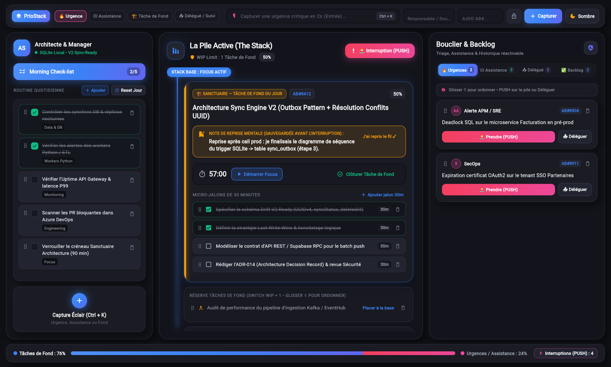

### 2.2 Thème Clair (« Light Soft UI »)
Pour travailler dans un environnement très lumineux, cliquez à tout moment sur le bouton **`🌙 Sombre` / `☀️ Clair`** situé tout en haut à droite de la barre supérieure. L'interface bascule instantanément vers une palette claire haute lisibilité :

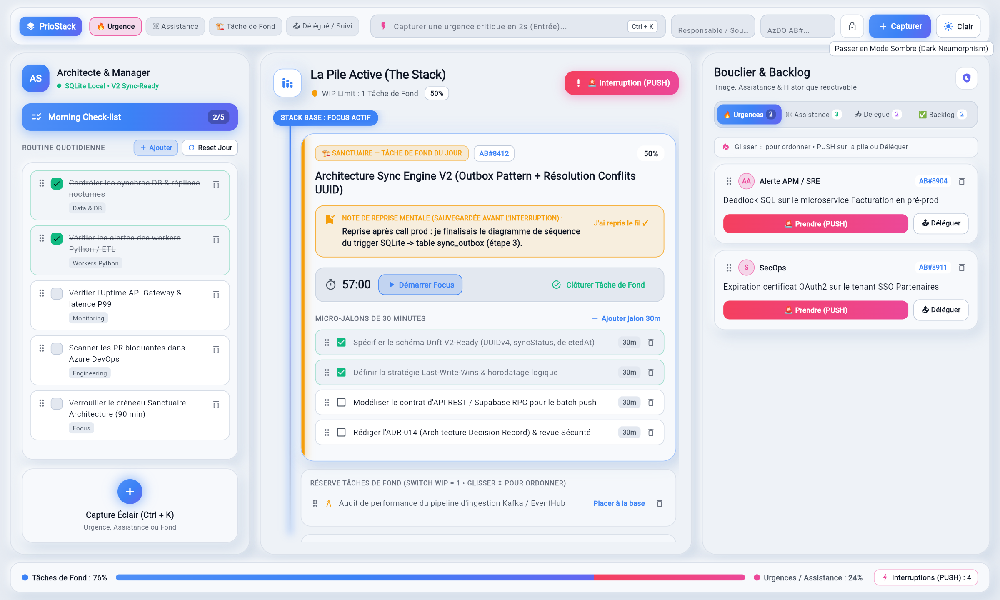

---

## 3. Pilier 1 : La Barre de Capture Éclair (`Ctrl + K`)

Située tout en haut de l'écran, la **Barre de Capture Éclair** vous permet de noter une sollicitation ou une tâche en **moins de 2 secondes** sans quitter votre travail des yeux.


### Comment capturer une tâche en 2 secondes :
1. **Activer la barre** : Appuyez sur le raccourci clavier global **`Ctrl + K`** (ou cliquez directement dans le champ de saisie ou sur le bouton bleu `+` en bas de la colonne gauche).
2. **Choisir la nature du flux** (à gauche de la barre) :
   - **`🔥 Urgence`** : Incident critique ou blocage de production (rejoint l'onglet *Urgences* du Bouclier).
   - **`🧑‍💻 Assistance`** : Question ou demande d'aide d'un développeur (rejoint l'onglet *Assistance* pour traitement groupé).
   - **`🏗️ Tâche de Fond`** : Sujet d'architecture, conception ou projet (s'active à la base de la pile si celle-ci est vide, sinon rejoint la *Réserve des Tâches de Fond*).
   - **`📤 Délégué / Suivi`** : Action confiée à un membre de l'équipe dont vous attendez le retour.
3. **Renseigner les métadonnées (optionnelles)** :
   - **Responsable / Source** : Nom du développeur, de l'interlocuteur ou du service émetteur (ex. *Lucas M.*, *SecOps*).
   - **Ticket Azure DevOps (`externalRef`)** : Référence du ticket (ex. `AB#8904`).
   - **Visibilité (`🔒 Privé` / `👥 Équipe`)** : Prépare le partage d'équipe pour la synchronisation V2.
4. **Valider** : Appuyez sur **`Entrée`** ou cliquez sur **`+ Capturer`**.

---

## 4. Pilier 2 (Zone 1) : La Morning Check-list (Routine Quotidienne)

La colonne de gauche est dédiée à votre **Routine Quotidienne d'Architecte & Manager** afin de sécuriser vos vérifications critiques dès le début de journée avant d'entrer en phase de *Deep Work*.

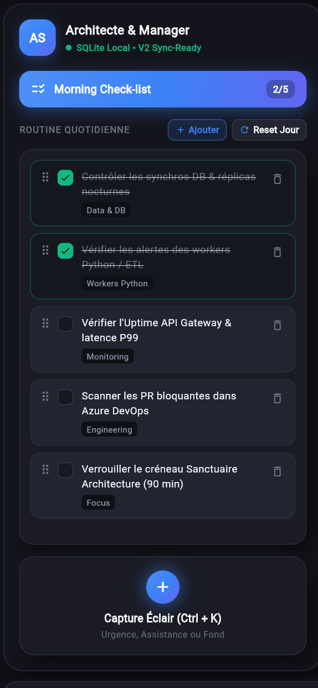

### Fonctionnalités de la Morning Check-list :
- **Indicateur d'avancement (`2/5`)** : Affiché dans la pilule bleue supérieure, il suit en temps réel le nombre de contrôles cochés.
- **Cocher / Décocher un contrôle** : Cliquez simplement sur une ligne pour la marquer comme vérifiée (bordure verte émeraude et texte barré).
- **Ajouter un point de contrôle (`+ Ajouter`)** :
  Cliquez sur le bouton **`+ Ajouter`** pour ouvrir la fenêtre de création d'une nouvelle vérification récurrente (titre + catégorie telle que *Data & DB*, *Monitoring*, *Workers Python*, *Sécurité*) :

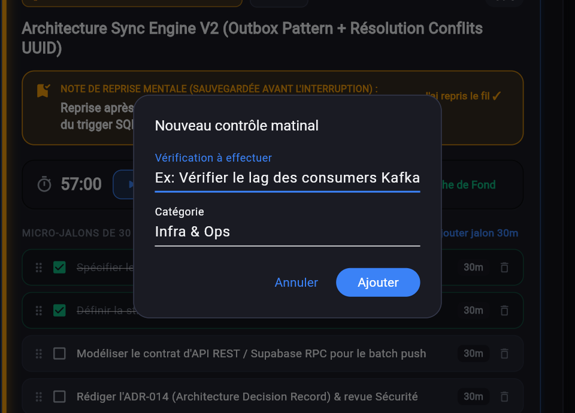

- **Supprimer un point de contrôle (`🗑️`)** : Cliquez sur l'icône corbeille à droite d'un élément pour le retirer de votre routine.
- **Réordonner par glisser-déposer (`⠿`)** : Maintenez la poignée `⠿` située à gauche d'une ligne et glissez-la vers le haut ou vers le bas pour ajuster l'ordre de votre routine matinale.
- **Réinitialisation quotidienne (`Reset Jour`)** : Chaque matin, cliquez sur **`Reset Jour`** pour décocher l'ensemble des vérifications d'un seul geste.

---

## 5. Pilier 3 (Zone 2) : La Pile Active (The Stack) — Sanctuaire & Mécanique PUSH / POP

La colonne centrale constitue le **cœur opérationnel de PrioStack**. Une ligne de vie verticale lumineuse relie visuellement le **sommet de la pile** (élément actuellement actif) aux éléments mis en pause en dessous.

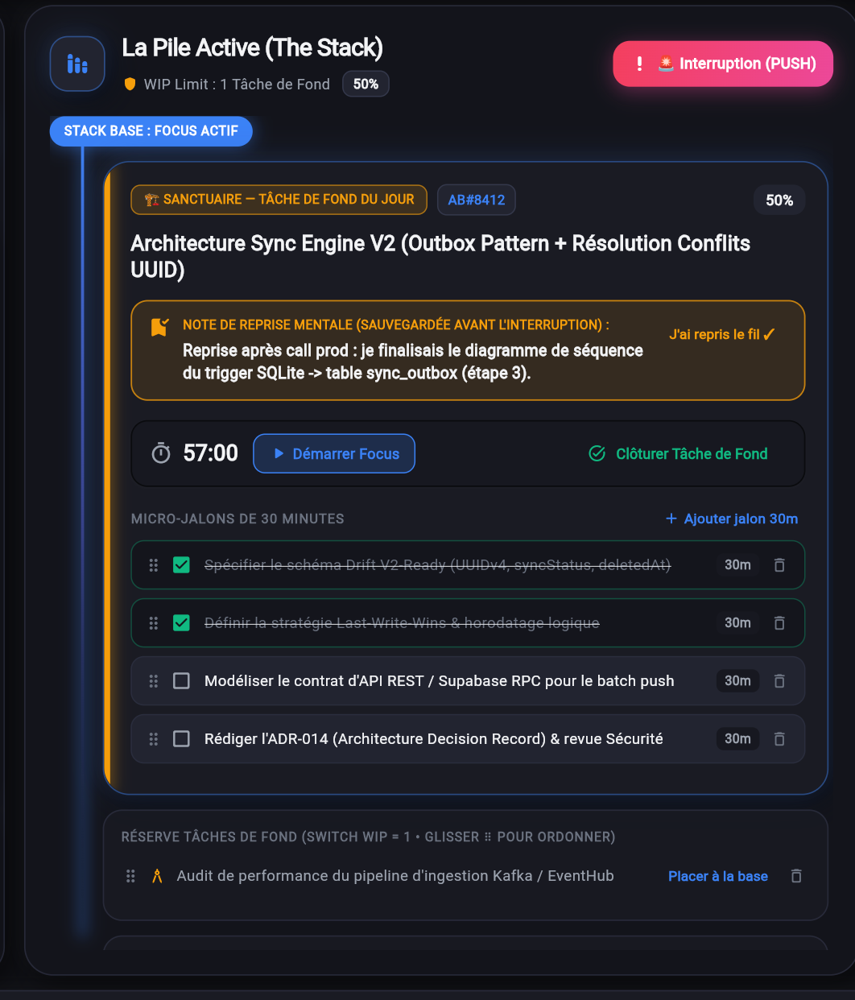

### 5.1 Le Sanctuaire de la Tâche de Fond (`WIP Limit = 1`)
- PrioStack impose une règle stricte de **WIP Limit = 1** sur le travail de fond : **une seule Tâche de Fond du Jour** peut être active à la base de la pile (`STACK BASE : FOCUS ACTIF`).
- Les autres sujets d'architecture sont stockés juste en dessous dans la section **`RÉSERVE TÂCHES DE FOND (SWITCH WIP = 1)`**.
- Si vous cliquez sur **`Placer à la base`** sur une tâche de la réserve, PrioStack permute automatiquement l'ancienne tâche de fond vers la réserve et place la nouvelle à la base de la pile.

### 5.2 Chronomètre Focus & Micro-Jalons de 30 minutes
- **Chronomètre Focus intégré** : Cliquez sur **`▶ Démarrer Focus`** pour lancer le suivi du temps sur la tâche au sommet de la pile. Ce compteur alimente en direct la jauge analytique inférieure (*% Tâches de Fond vs % Urgences / Assistance*).
- **Découpage en Micro-Jalons de 30 minutes** :
  - Chaque Tâche de Fond est subdivisée en sous-objectifs cochables de 30 minutes afin de maintenir un rythme de progression concret.
  - Cliquez sur **`+ Ajouter jalon 30m`** pour ajouter une étape.
  - Utilisez la poignée **`⠿`** pour réordonner vos jalons par glisser-déposer, ou l'icône **`🗑️`** pour supprimer un jalon.
  - Le pourcentage d'avancement (ex. `50%`) en haut à droite de la carte se recalcule automatiquement à chaque jalon coché.
- **Clôturer la Tâche de Fond** : Une fois le livrable terminé, cliquez sur **`✅ Clôturer Tâche de Fond`** pour l'archiver dans le Backlog des tâches réalisées.

---

### 5.3 Déclencher une Interruption (`🚨 PUSH`)
Lorsqu'une urgence survient et que vous devez interrompre immédiatement votre Tâche de Fond :
1. Cliquez sur le bouton rose **`🚨 Interruption (PUSH)`** en haut à droite de la Pile Active (ou sur le bouton **`🚨 Prendre (PUSH)`** d'une carte de l'onglet *Urgences*).
2. **Pause automatique** : PrioStack met instantanément en pause votre chronomètre Focus.
3. **Saisie de la Note de reprise mentale (optionnelle et non bloquante)** : Une boîte de dialogue s'ouvre et vous propose :
   > *« 1. Note de reprise mentale (optionnelle) : où en étais-tu ? »*

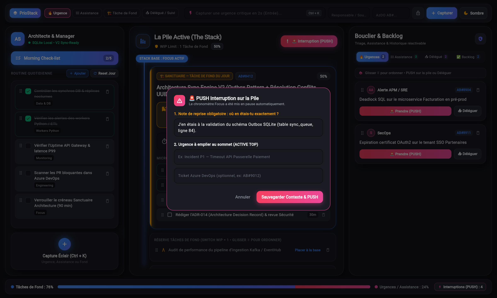

4. Cliquez sur **`Sauvegarder Contexte & PUSH`**.
5. **État de la Pile après le PUSH (`STACK DEPTH : 2`)** :
   - L'urgence prend place au **sommet de la pile** (`🔥 SOMMET DE PILE — INTERRUPTION EN COURS`) avec une bordure néon rose.
   - Votre Tâche de Fond descend d'un cran en statut **`⏸️ EN PAUSE DANS LA PILE (ATTENTE POP)`** avec votre **Note de reprise verrouillée** visible sous forme de cadenas ambre :

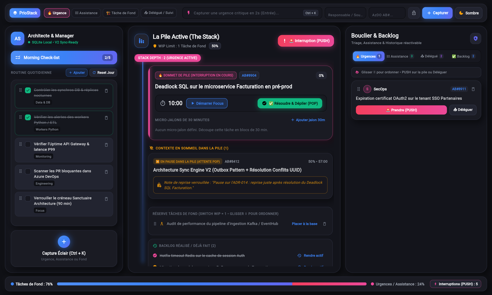

> **Empilements multiples (Niveaux 2, 3...)** : Si une seconde urgence encore plus critique survient pendant que vous traitez la première, vous pouvez refaire un **PUSH** ! La pile passera en `STACK DEPTH : 3` et dépilera chaque urgence dans l'ordre inverse d'arrivée (*Last-In, First-Out*).

---

### 5.4 Résoudre l'Urgence et Dépiler (`✅ POP`)
1. Une fois l'urgence au sommet résolue, cliquez sur le bouton vert émeraude **`✅ Résoudre & Dépiler (POP)`**.
2. L'urgence passe automatiquement à l'état **`FAIT`** (et rejoint l'historique du Backlog).
3. Votre **Tâche de Fond du Jour** remonte immédiatement au sommet de la pile et affiche en évidence un **encadré ambre lumineux** contenant la **Note de reprise mentale** que vous aviez rédigée avant l'interruption.
4. Dès que vous avez repris le fil de votre réflexion, cliquez sur **`J'ai repris le fil ✓`** pour masquer la bannière et relancer votre chronomètre Focus.

---

## 6. Pilier 4 (Zone 3) : Bouclier Manager, Assistance & Backlog Réalisé

La colonne de droite agit comme un **sas de filtrage et de protection** (*Bouclier Manager*) organisé en **4 onglets** avec compteurs temps réel :

### 6.1 Onglet `🔥 Urgences`
Regroupe les alertes et incidents critiques en attente de prise en charge.

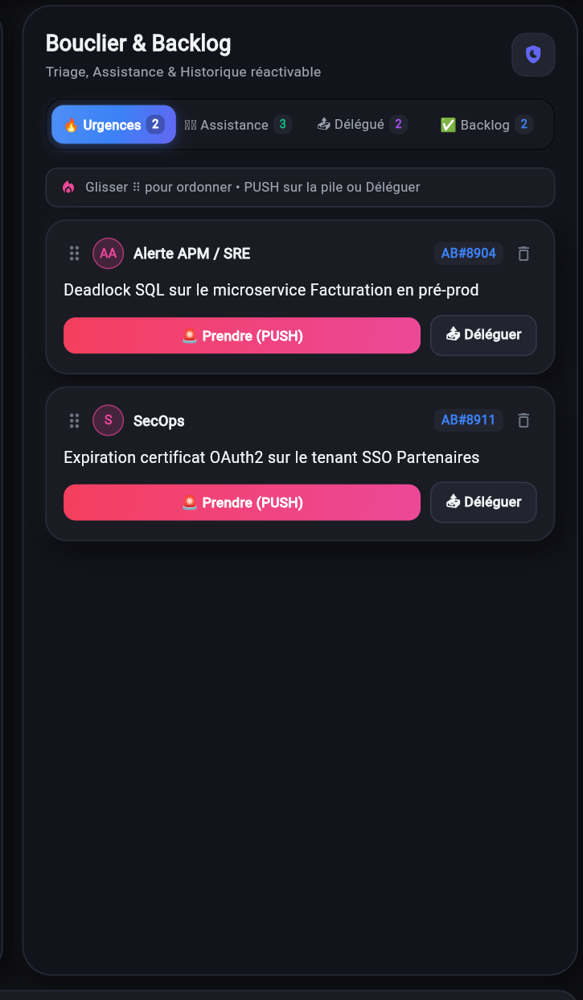

Sur chaque carte d'urgence, vous disposez de deux décisions managériales :
- **`🚨 Prendre (PUSH)`** : Interrompt votre tâche en cours (après sauvegarde de votre note de reprise) et place cette urgence au sommet de votre Pile Active.
- **`📤 Déléguer`** : Ouvre une fenêtre pour assigner l'urgence à un membre de votre équipe ; la carte bascule alors automatiquement dans l'onglet **`📤 Délégué`** avec une visibilité `TEAM`.

---

### 6.2 Onglet `🧑‍💻 Assistance` (Traitement par lots / Batching)
Centralise toutes les sollicitations techniques des développeurs (*revues de PR, questions d'architecture, arbitrages SQL/DTO*) afin que vous puissiez les traiter en une seule session groupée (*Batching*) plutôt que de subir 10 micro-interruptions dans la journée.

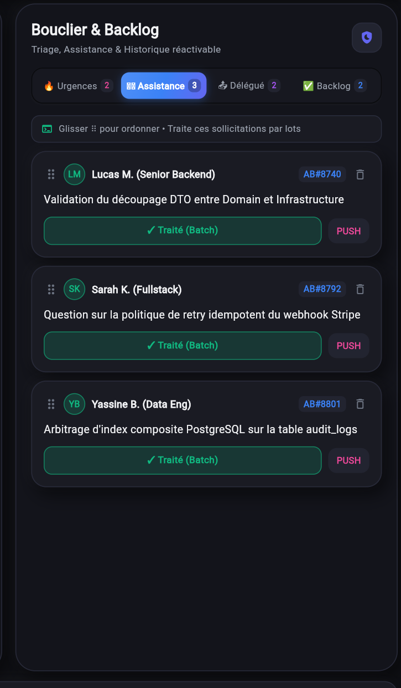

- **`✓ Traité (Batch)`** : Clôture immédiatement la demande d'assistance en 1 clic une fois la réponse apportée au développeur.
- **`PUSH`** : Si la question révèle un blocage critique nécessitant une session de travail dédiée maintenant, empile la demande au sommet de votre Pile Active.

---

### 6.3 Onglet `📤 Délégué` (Suivi Équipe)
Permet de suivre d'un coup d'œil toutes les tâches et urgences que vous avez confiées à des membres de votre équipe, avec le nom du responsable assigné, la référence Azure DevOps et le bouton **`Validé / Reçu ✓`** pour clore le suivi dès réception du livrable.

---

### 6.4 Onglet `✅ Backlog` (Historique réalisé & Réactivation en 1 clic)
L'onglet **`✅ Backlog`** (ainsi que le récapitulatif en bas de la colonne centrale) conserve la trace de **toutes les tâches terminées** (Tâches de Fond clôturées, Urgences dépilées via POP, Assistances traitées et Délégations validées).

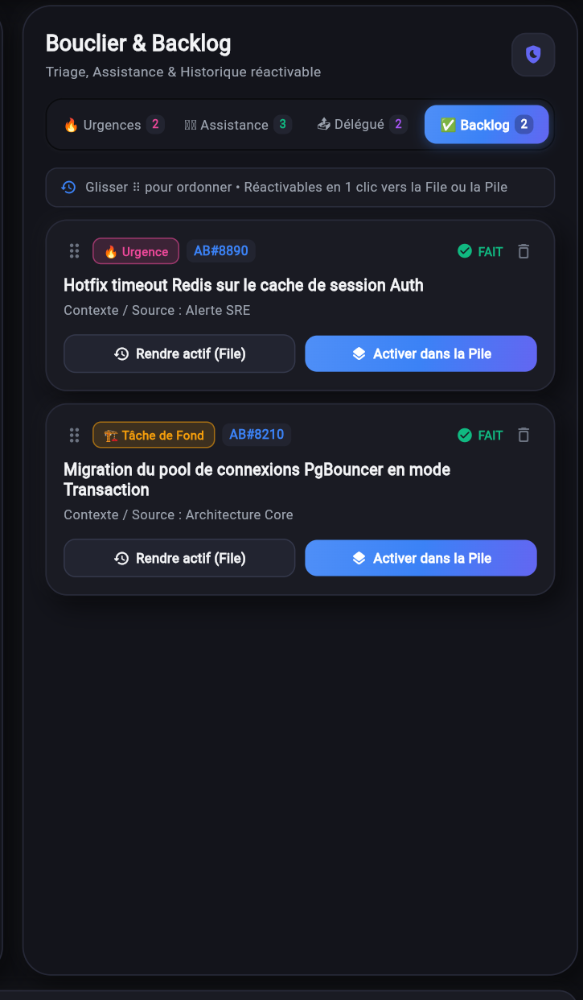

Si un sujet résolu nécessite d'être rouvert (ex. *un hotfix qui rebondit ou un chantier d'architecture à compléter*), deux boutons vous permettent de **le rendre de nouveau actif** :
- **`↺ Rendre actif (File)`** : Remet la tâche dans sa file d'attente d'origine (*Urgences*, *Assistance*, *Délégué* ou *Réserve de Fond*).
- **`🥞 Activer dans la Pile`** : Propulse immédiatement la tâche dans votre **Pile Active** centrale pour travailler dessus tout de suite.

---

## 7. Réorganisation par Glisser-Déposer (Drag & Drop `⠿`)

Toutes les listes de PrioStack intègrent une poignée de glissement **`⠿`** permettant d'ordonner manuellement vos priorités à la souris ou au doigt :
- **Morning Check-list (Zone 1)** : Glissez **`⠿`** pour ordonner votre routine matinale.
- **Micro-jalons de 30 minutes (Zone 2)** : Glissez **`⠿`** pour séquencer les étapes de votre Tâche de Fond.
- **Réserve des Tâches de Fond (Zone 2)** : Glissez **`⠿`** pour classer vos prochains chantiers d'architecture.
- **Files Urgences, Assistance, Délégué & Backlog (Zone 3)** : Glissez **`⠿`** en haut à gauche de chaque carte pour ordonner vos priorités de traitement.

> L'ordre défini par glisser-déposer est immédiatement persisté en base de données (`sortOrder` / `stackOrder`).

---

## 8. Barre de Statut Analytique Inférieure

Tout en bas du Cockpit, la **Barre de Statut Analytique** synthétise la santé de votre journée en temps réel :

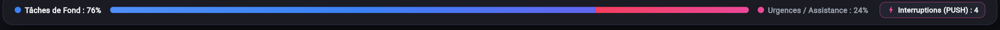

1. **Ratio `% Tâches de Fond` (Bleu) vs `% Urgences / Assistance` (Rose)** :
   Calculé automatiquement à partir du temps effectif mesuré par le Chronomètre Focus sur vos tâches de fond par rapport au temps passé sur les urgences et demandes d'assistance.
2. **Compteur `⚡ Interruptions (PUSH)`** :
   Indique le nombre total de bascules de contexte (PUSH) subies dans la journée — un indicateur factuel précieux en rétrospective d'équipe ou en comité de direction pour illustrer la pression opérationnelle.

---

## 9. Raccourcis Clavier & Astuces de Productivité

| Raccourci / Action | Effet dans PrioStack |
| :--- | :--- |
| **`Ctrl + K`** | Place immédiatement le curseur dans la **Barre de Capture Éclair** supérieure. |
| **`Entrée`** *(dans la barre de capture)* | Enregistre instantanément la tâche saisie dans la file correspondante. |
| **Clic sur `🌙 Sombre` / `☀️ Clair`** | Bascule instantanément entre le thème **Dark Neumorphism** et le thème **Light Soft UI**. |
| **Glisser-déposer sur `⠿`** | Réordonne les contrôles matinaux, les micro-jalons de 30m ou les cartes de tâches. |
| **Clic sur `🗑️`** | Supprime proprement (*Soft-Delete V2-Ready*) un contrôle, un jalon ou une tâche. |

---

## 10. Pilier 5 : Le Calendrier & Agenda Intelligent (PUSH Réunion)

Le **Calendrier & Agenda** de PrioStack comble le fossé entre vos réunions programmées et votre gestion dynamique des urgences :

1. **Double vue adaptative** :
   * **Vue Mensuelle** : Grille du mois avec pastilles colorées selon la nature des réunions (*Bleu pour les points projet*, *Rose pour les urgences*, *Violet pour l'architecture*).
   * **Vue Agenda du Jour** : Liste chronologique des créneaux de la journée avec horaires de début et fin, participants et ordre du jour.
2. **Mécanique `🚨 Rejoindre (PUSH dans la Pile)`** :
   À l'heure d'une réunion importante, un clic sur le bouton **Rejoindre** de la carte :
   * Met immédiatement en pause votre tâche de fond courante.
   * Ouvre la modale de **Note de reprise mentale** pour mémoriser l'état d'avancement de votre travail.
   * Empile la réunion au sommet de votre Pile Active et vous redirige vers le Cockpit de travail.
3. **Liaison instantanée avec les Notes** : Chaque événement dispose d'un bouton direct `📝 Notes` pour ouvrir immédiatement le compte-rendu associé.

---

## 11. Pilier 6 : Prise de Notes de Réunions avec Sauvegarde Automatique

Pour éviter la dispersion dans des outils externes ou les pertes de données en cours de réunion, PrioStack intègre un **Éditeur de Notes de Réunion dédié** :

1. **Sauvegarde automatique continue (Auto-Save)** :
   Toutes les notes saisies sont sauvegardées en arrière-plan à la moindre frappe dans la base PostgreSQL Neon Cloud ainsi qu'en cache local. Même en cas de rechargement intempestif ou de coupure réseau, **aucune note n'est perdue**.
2. **Association aux rendez-vous de l'agenda** :
   Une note peut être créée librement ou rattachée à une réunion spécifique de votre calendrier. Le titre, la date et la liste des participants sont alors synchronisés automatiquement.
3. **Structure adaptative** :
   * Sur PC : Liste des comptes-rendus à gauche et éditeur plein texte à droite.
   * Sur Mobile : Vue fluide de la liste, puis ouverture en plein écran de l'éditeur avec bouton de retour `← Liste des notes`.

---

## 12. Pilier 7 : Expérience Responsive & Navigation Mobile

PrioStack offre une interface entièrement responsive adaptée aux smartphones et tablettes :

1. **Barre de navigation inférieure à 5 onglets** :
   * `Morning` : La check-list matinale.
   * `Pile` : La pile d'exécution active avec son chronomètre.
   * `Triage` : Les files Urgences, Assistance et Délégué.
   * `Agenda` : L'agenda du jour et le calendrier mensuel.
   * `Notes` : L'éditeur et l'historique des notes de réunion.
2. **En-têtes et modales adaptatifs** :
   Les barres supérieures et modales de dialogue basculent automatiquement sur des architectures fluides à plusieurs rangées sans aucun dépassement horizontal ni titre compressé.
3. **Bannières de notifications fluides** :
   Les alertes de réunion et de modifications d'état s'affichent sous forme de bannières compactes adaptées aux petits écrans.

---

## 13. Pilier 8 : Synchronisation Temps Réel Multi-Écrans

PrioStack assure la cohérence parfaite de votre cockpit sur tous vos équipements :

* **Inter-onglets instantané (< 10 ms)** : Si vous travaillez avec plusieurs onglets ouverts sur votre ordinateur, une tâche ajoutée ou cochée dans l'un se répercute instantanément sur les autres via l'API HTML5 `BroadcastChannel`.
* **Multi-postes en continu (3,5 s)** : Grâce au polling intelligent avec dédoublonnage de requêtes (*in-flight coalescing*), un changement fait depuis votre smartphone est synchronisé sur votre poste fixe en moins de 4 secondes sans surcharge réseau.

---

## 14. Pilier 9 : Sécurité & Validation Administrateur

Pour préserver la confidentialité des architectures d'entreprise et des échanges d'équipe :

1. **Workflow d'approbation d'accès** :
   Toute nouvelle création de compte via l'écran d'inscription public nécessite l'approbation explicite d'un administrateur. Tant que le compte n'est pas validé, toute tentative de connexion est bloquée avec le message explicatif approprié.
2. **Panneau d'administration intégré** :
   Les administrateurs disposent d'un écran dédié pour consulter la liste des inscrits, approuver de nouveaux collaborateurs ou révoquer des accès.
3. **Sécurité cryptographique** :
   Les mots de passe sont salés et hachés avec `bcryptjs` et les communications sont chiffrées de bout en bout via SSL / HTTPS et JWT.

---

## 15. Pilier 10 : Déploiement Web Apache / Plesk

PrioStack peut être déployé comme sous-site ou sous-dossier sur votre hébergement web (ex. `https://www.damel-it.com/priostack/`) :

1. Exécutez le script d'empaquetage automatisé :
   ```powershell
   powershell -ExecutionPolicy Bypass -File .\package_damel_it.ps1
   ```
2. Récupérez l'archive produite :
   `dist/damel-it/priostack_damel_it.zip`
3. Téléversez et extrayez cette archive dans le répertoire `/priostack/` de votre gestionnaire de fichiers Plesk ou cPanel.
4. Le fichier `.htaccess` pré-configuré prend en charge le routage SPA afin d'éviter toute erreur 404 lors des rechargements de page.

---

## 16. Architecture Technique Hybride (Neon Cloud + SQLite)

- **Mode Cloud Connecté (PostgreSQL Neon.tech)** : Synchronisation distante 24/7 via l'API REST sécurisée hébergée sur Render (`https://priostack-api.onrender.com`).
- **Persistance Locale SQLite (Windows Desktop / Hors-ligne)** : Base SQLite locale gérée par Drift (`priostack_v1.sqlite`), offrant une réactivité instantanée et un fonctionnement 100 % hors-ligne.
- **Journalisation Automatique** : Toutes les traces techniques sont enregistrées dans `logs/flutter_debug.log`.
